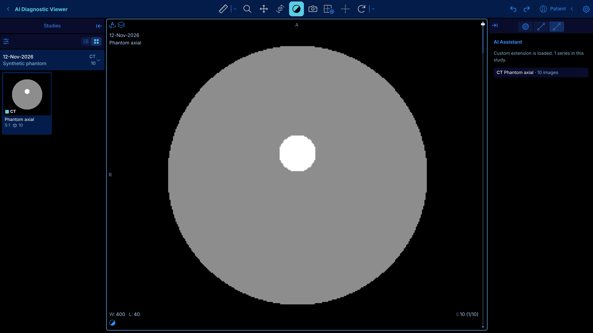

# Customizing this OHIF copy

Base: OHIF Viewer **v3.13.14** (stable), on branch `custom`. Upstream is the `upstream` git remote.



## Run it

Requirements: **Node 24+** and **pnpm 12** (`npm i -g pnpm@12.8.1`).

```bash
CYPRESS_INSTALL_BINARY=0 pnpm install
pnpm dev:custom          # http://localhost:3000
```

`pnpm dev` still runs stock OHIF (config/default.js), handy for comparison.

- Demo studies load from OHIF's public server at http://localhost:3000.
- Your own DICOM files: open http://localhost:3000/local, drop a folder, select the study, then click **Basic Viewer**.
- Edits to the extension or config hot-reload (refresh the page for config changes).

## Where customizations live

All changes are kept out of OHIF's own code so upstream updates merge cleanly.

| What | File |
|---|---|
| Branding, data sources, which extensions load, panel layout | `platform/app/public/config/custom.js` (look for `CUSTOM` comments) |
| Your code: panels, tools, commands, viewports | `extensions/ai-viewer/src/` |
| Example panel | `extensions/ai-viewer/src/panels/AIAssistantPanel.tsx` |
| Extension registration | `platform/app/pluginConfig.json` (one entry) |

### Common changes

- **Rename or re-logo the header:** edit `whiteLabeling` in `custom.js`.
- **Point at your own PACS/archive:** change the `ohif` entry in `dataSources` in `custom.js` (Orthanc example: `config/local_orthanc.js`).
- **Add a panel:** add an entry in `extensions/ai-viewer/src/getPanelModule.tsx`, then push
  `'@ohif/extension-ai-viewer.panelModule.<name>'` into `rightPanels` or `leftPanels` in `custom.js`.
- **Add toolbar buttons or commands:** add `getToolbarModule` / `getCommandsModule` to
  `extensions/ai-viewer/src/index.tsx`. Use `extensions/default` and `extensions/cornerstone` as references.
- **Read viewer state:** use `servicesManager.services` (displaySetService, measurementService,
  viewportGridService, segmentationService, ...) and subscribe to their events, as the example panel does.

## Pull upstream updates

```bash
git fetch upstream tag v3.13.15 --no-tags
git merge v3.13.15
```
