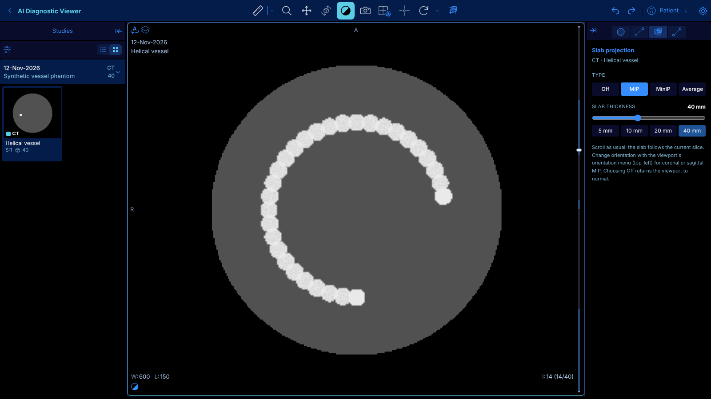
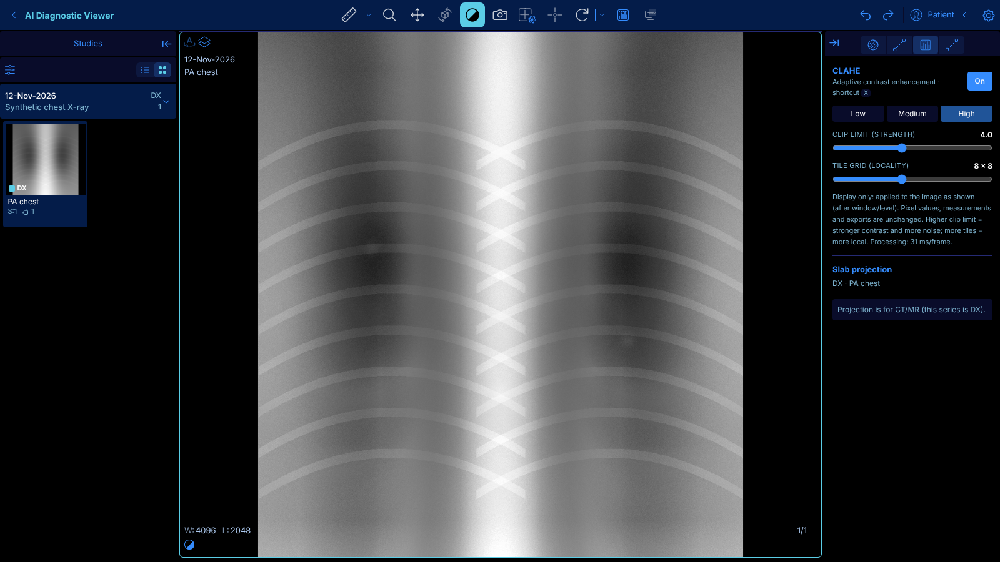

# Customizing this OHIF copy

Base: OHIF Viewer **v3.13.14** (stable), on branch `custom`. Upstream is the `upstream` git remote.


## Run it

Requirements: **Node 24+** and **pnpm 12** (`npm i -g pnpm@12.8.1`).

```bash
CYPRESS_INSTALL_BINARY=0 pnpm install
pnpm dev:custom          # http://localhost:3000
```

`pnpm dev` still runs stock OHIF (config/default.js), handy for comparison.

- Demo studies load from OHIF's public server at http://localhost:3000.
- Your own DICOM files: open http://localhost:3000/local, drop a folder, select the study, then click **Basic Viewer**.
- Edits to the extension or config hot-reload (refresh the page for config changes).

## Where customizations live

All changes are kept out of OHIF's own code so upstream updates merge cleanly.

| What | File |
|---|---|
| Branding, data sources, which extensions load, panel layout | `platform/app/public/config/custom.js` (look for `CUSTOM` comments) |
| Your code: panels, tools, commands, viewports | `extensions/ai-viewer/src/` |
| Example panel | `extensions/ai-viewer/src/panels/AIAssistantPanel.tsx` |
| Extension registration | `platform/app/pluginConfig.json` (one entry) |

### Common changes

- **Rename or re-logo the header:** edit `whiteLabeling` in `custom.js`.
- **Point at your own PACS/archive:** change the `ohif` entry in `dataSources` in `custom.js` (Orthanc example: `config/local_orthanc.js`).
- **Add a panel:** add an entry in `extensions/ai-viewer/src/getPanelModule.tsx`, then push
  `'@ohif/extension-ai-viewer.panelModule.<name>'` into `rightPanels` or `leftPanels` in `custom.js`.
- **Add toolbar buttons or commands:** add `getToolbarModule` / `getCommandsModule` to
  `extensions/ai-viewer/src/index.tsx`. Use `extensions/default` and `extensions/cornerstone` as references.
- **Read viewer state:** use `servicesManager.services` (displaySetService, measurementService,
  viewportGridService, segmentationService, ...) and subscribe to their events, as the example panel does.

## Feature: on-the-fly slab projection (MIP / MinIP / Average)



For CT, MR (and PT) series that can be built into a volume:

- **Toolbar / shortcut:** the **MIP** button (right end of the main toolbar) or the **M** key toggles MIP on the active viewport.
- **Right panel → "Image Tools" tab → Slab projection:** choose Off / MIP / MinIP / Average and set slab thickness
  (slider 1–100 mm, or the 5/10/20/40 mm presets). Changes apply live.
- Scroll as usual; the slab follows the current slice. Use the viewport orientation menu (top-left) for
  coronal/sagittal projections. Your slice position is kept when switching on and off.
- From code or a hotkey: `commandsManager.runCommand('aiSetProjection', { mode: 'mip', slabThickness: 20 })`
  (`mode`: `off | mip | minip | avg`) or `runCommand('aiToggleMIP')`.

How it works: the viewport is switched from a stack to a Cornerstone volume viewport through OHIF's normal
viewport pipeline, with a projection blend mode and slab thickness. Later changes are applied directly to the
live viewport. Code: `extensions/ai-viewer/src/projection/projection.ts`, panel in
`extensions/ai-viewer/src/panels/ProjectionPanel.tsx`, toolbar button in `config/custom.js` (`aiToolbar()`).

## Feature: CLAHE contrast enhancement (X-ray)



Contrast Limited Adaptive Histogram Equalization brings out subtle detail (bone edges, lines, nodules) across
both dark and bright regions of an image. Built for X-ray (CR/DX/MG/XA), and works on any 2D viewport.

- **Toolbar / shortcut:** the **CLAHE** button (histogram icon, next to MIP) or the **X** key toggles it on the
  active viewport. The button turns blue while on.
- **Right panel → "Image Tools" tab → CLAHE:** On/Off, **Low / Medium / High** presets, and sliders for
  **clip limit** (strength, 1–8) and **tile grid** (how local the enhancement is, 2–16).
- **Display only:** applied to the image as shown, after window/level, so it combines with W/L, zoom, pan and
  annotations. Stored pixel values, measurements and exports are unchanged. Pure-black background is left black.
- From code: `commandsManager.runCommand('aiSetCLAHE', { enabled: true, clipLimit: 3, tiles: 8 })`
  or `runCommand('aiToggleCLAHE')`.

How it works: after Cornerstone draws a viewport it fires `IMAGE_RENDERED`; a listener runs CLAHE on that
viewport's canvas pixels (~25–30 ms for a full-screen viewport). Code: `extensions/ai-viewer/src/clahe/`
(`clahe.ts` = algorithm, `claheController.ts` = per-viewport state + render hook), panel in
`extensions/ai-viewer/src/panels/ClaheSection.tsx`. Shortcuts are in `config/custom.js`
(`ohif.hotkeyBindings`) and can be changed in Settings → Hotkeys.

## Pull upstream updates

```bash
git fetch upstream tag v3.13.15 --no-tags
git merge v3.13.15
```
